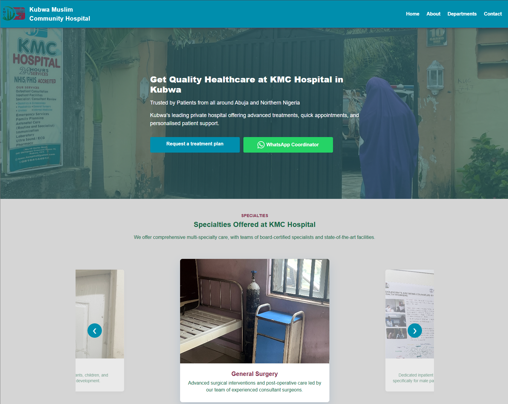

# KMC Hospital Website

A responsive website for **Kubwa Muslim Community Hospital** (Kubwa, Abuja). It gives patients a clear way to find the hospital's departments, contact details and opening hours on any screen size.

Built with React and Vite as a developer intern on Aptech's responsive web design team.

**[Live demo](https://kmc-hospital-seven.vercel.app)**



## Features

- **Departments:** a page listing all 12 departments with images and descriptions, and a Home carousel of five featured departments (auto-advances, pauses on hover, supports arrows and swipe).
- **Contact:** address, phone, email, opening hours, an embedded Google Map, phone and email links, and WhatsApp buttons.
- **About:** the hospital's story, four stat cards and four facility cards.
- **FAQ:** an accordion with seven questions, one answer open at a time.
- **Responsive, mobile-first layout:** phone layout by default, with a 768px breakpoint for tablet and desktop. Hamburger navigation on phones, inline links on wider screens. Built with Flexbox and CSS Grid.
- **Content kept separate from components:** departments, FAQs, facilities and stats live in `src/data/`, so content changes don't touch the interface code.

## Tech stack

- React 19 with function components and hooks
- Vite 8
- React Router 7 for client-side routing
- Plain CSS, with one stylesheet per page or component
- ESLint 10 (React hooks and React refresh plugins)
- Deployed on Vercel

## Project structure

```
kmc-hospital/
├── public/
├── src/
│   ├── assets/site-images/    photos, logo and icons
│   ├── components/            Navbar, Footer, HeroSection, SpecialtiesSpinner,
│   │                          FAQSection, CTAHome, CTASection
│   ├── data/                  departments, faqs, facilities, aboutstats
│   ├── pages/                 Home, About, Departments, Contact
│   ├── styles/                one CSS file per page or component
│   ├── App.jsx                router and page layout
│   ├── main.jsx               app entry point
│   └── index.css              global styles and design tokens
├── index.html
├── package.json
├── vite.config.js
└── eslint.config.js
```

## Getting started

You need Node.js 20 or later.

```bash
git clone https://github.com/JeanFather/kmc-hospital.git
cd kmc-hospital
npm install
npm run dev
```

Then open the local address Vite prints (usually `http://localhost:5173`).

| Command | What it does |
| --- | --- |
| `npm run dev` | Starts the development server |
| `npm run build` | Creates the production build in `dist/` |
| `npm run preview` | Serves the production build locally |
| `npm run lint` | Runs ESLint |

## Known limitations and roadmap

- The appointment form is built but does not send data anywhere yet.
- Doctor profiles are not built yet.
- Health resources are limited to the FAQ section.
- One layout bug on the Contact page at tablet widths.
- Responsive behaviour still needs testing on physical devices.

## Author

**Olisaemeka Oguine**, Computer Science student at Nile University of Nigeria.
[GitHub](https://github.com/JeanFather)